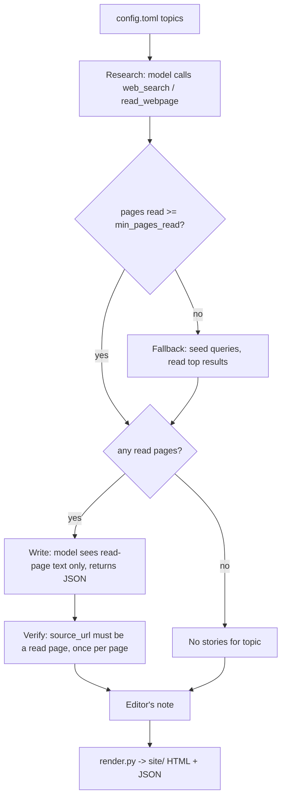

# Read the content of the folder and review the code

| | |
|---|---|
| Date | 2026-10-16 |
| Time | 10:29 (5 min) |
| Project | `C:\Users\micha\Claude\Coding Projects\family-newsletter` |
| Turns | 3 |
| Files changed | 6 |

## Summary

Three fixes were made to the family newsletter agent: page text is decoded with the right character set (#1), Tailscale and other non-public addresses are blocked from fetching (#2), and one malformed model response no longer crashes a run (#4). A fourth change (#3) makes the agent publish only stories whose source page it actually opened and read. Snippet-only sources are no longer accepted. All of this was checked offline with stand-in models; no full run against Ollama on the server has been done.

## Architecture

| File | Responsibility |
|---|---|
| `newsletter_agent.py` | Orchestrates the run. `Ollama` is the chat client, `TopicResearcher` runs research, writing and verification for one topic, and `main()` assembles and saves the issue. |
| `webtools.py` | `WebTools` does DuckDuckGo search (`ddgs`) and page reading. It fetches with manual redirect handling, decodes, and extracts text with trafilatura (BeautifulSoup as fallback). |
| `render.py` | Renders the issue and index to HTML. Not included in the record. The README says it escapes all model text. |
| `config.toml` | Topics, model and research settings. Not included in the record. |
| `README.md` | Documents the pipeline and safety notes. Updated to say "read" instead of "saw". |

Per topic, `TopicResearcher` works as follows:

1. **Research.** The model calls `web_search` and `read_webpage` within `max_tool_calls`.
2. **Fallback.** If fewer than `min_pages_read` pages were read, the seed queries run directly and the top results are read.
3. **Write.** The model receives the full text of read pages only and returns JSON stories.
4. **Verify.** Each story's `source_url` must match a read page, and each page can be used once.

`TopicResearcher.seen` maps `norm(url)` to an entry (`url`, `title`, `snippet`, `text`). `norm` strips whitespace and a trailing `/` and lowercases. An entry counts as read only when `text` is non-empty. After a redirect, the same entry is registered under both the original and final URL. `pages_read()` and the verify step deduplicate by `id(entry)`.



Fetch path in `WebTools._fetch`:

- Each hop, including every redirect, goes through `_check_url`.
- Redirects are followed manually, up to 5.
- Up to 5 MB is read, then passed to `_decode`.
- Extracted text is truncated to `max_page_chars`.

Extension points:

- `WebTools` is the only search and read implementation. The README suggests swapping it for self-hosted SearXNG.
- Topics, model, `items`, `min_pages_read`, `max_tool_calls` and `block_private_addresses` are config-driven.

## Key decisions

- **Decode order for page text (#1).** `_decode` tries the HTTP header charset, then a `<meta ... charset>` tag in the first 4096 bytes. If neither is usable, it tries UTF-8 and falls back to Windows-1252. The reason is that `requests` assumes ISO-8859-1 for `text/*` without a charset, which garbled UTF-8 pages. An unknown charset name (`LookupError`) is skipped rather than failing.
- **Allow-list for addresses (#2).** `_check_url` blocks any resolved address that is not `is_global`, plus multicast addresses. A blocklist based on `is_private` missed the CGNAT range `100.64.0.0/10`, which includes Tailscale's `100.100.100.100`.
- **Defensive handling of model output (#4).**
  - The `text()` helper coerces null or wrong-typed fields to a string.
  - `write` ignores non-dict items and non-list `stories`.
  - Stories with an empty headline or summary are dropped.
  - `main()` catches errors per topic, separating `requests.RequestException` from other exceptions.
  - A failed editor's note no longer blocks publishing.
- **Read pages only (#3).** The user chose that snippets are excluded from the writer's prompt, not just from verification. The reasoning in the code comment is that snippets are too thin to write from. If a topic has no read pages, the writer call is skipped and the topic gets no stories.
- **Dedupe per page, not per URL.** A story could cite both a short link and its redirect target. Verification keys on the entry's identity, and the published `source_url` and `source_title` come from the registered entry (the final URL), not from the model's text.
- **Empty issues are not published.** `main()` exits if no topic produced stories.

## How to run and test

Run the agent as documented in the README:

```bash
bash install.sh                                   # on the Ubuntu server
sudo systemctl start newsletter                   # build an issue now
journalctl -u newsletter -f                       # watch progress
.venv/bin/python newsletter_agent.py --topic "Tech & AI" --model gpt-oss:20b
```

Offline probes were run from a scratchpad directory, using a venv with the project's requirements installed. Each takes the project folder as its first argument (`sys.argv[1]`):

```bash
python probe.py  <project-dir>   # renderer escaping, blocked addresses, charset via a local HTTP server,
                                 # verify step, malformed story, live DuckDuckGo search and read
python probe2.py <project-dir>   # _decode (5 cases), _check_url (incl. 100.64.0.5, cbc.ca),
                                 # write()/write_intro() with null, list and mixed model output
python probe3.py <project-dir>   # read-only sources, redirect aliases, duplicate citations, snippet exclusion
```

Results reported in the session:

- **Decoding.** "Café “Montréal”" decoded correctly in all five cases, including a bogus charset name.
- **Addresses.** Previously blocked addresses are still blocked, and cbc.ca is still allowed.
- **Verification.** Of four test citations, only the page that was really read got through. The record cuts off the rest of that result.

The probe scripts print results rather than assert them, and they live outside the project folder, so they are not part of an automated test suite.

## Limitations and follow-ups

- **No end-to-end run.** The real Ollama run on the server has not been tried.
- **Truncated source text.** Page text is cut to `max_page_chars` (default 5000), so the model only sees that much of each source.
- **"Read" means text was extracted.** It does not mean the story's claims match the page. The prompt tells the model to use only facts from the sources, but nothing checks that.
- **Case-insensitive URL matching.** `norm` lowercases URLs, so two paths that differ only in case are treated as the same page.
- **Address check and connection are separate.** `_check_url` resolves the hostname itself, and `requests` then resolves it again to connect. The record shows no protection against the address changing between the two.
- **Port used in the check.** The check uses `parsed.port or 443`, even for plain `http` URLs.
- **Not covered by the record.**
  - `render.py` was not shown, so the "No verified stories this week" message comes only from the README.
  - The `main()` listing is cut off after the issue is saved, so index generation is not documented here.
- **Review points not in the record.** Only #1–#4 are mentioned. The rest of the code review, and any remaining items, are not recorded, and security hardening was deliberately deferred by the user.

## Goals

1. read the content of the folder and review the code
2. for security, the server is not exposed to the outside of my internal home network and doesn't contain sensitive data, so security is not the biggest concern yet. start by fixing point #1, #2 and #4
3. Fix #3: only publish stories whose source page was actually read.

## Files changed

| File | Change | Edits |
|---|---|---|
| `C:/Users/micha/AppData/Local/Temp/claude/C--Users-micha-Claude-Coding-Projects-family-newsletter/9f19cb47-ea13-4106-9728-f4b1ce1636f9/scratchpad/probe.py` | created | 1 |
| `webtools.py` | modified | 3 |
| `newsletter_agent.py` | modified | 11 |
| `C:/Users/micha/AppData/Local/Temp/claude/C--Users-micha-Claude-Coding-Projects-family-newsletter/9f19cb47-ea13-4106-9728-f4b1ce1636f9/scratchpad/probe2.py` | created | 1 |
| `README.md` | modified | 2 |
| `C:/Users/micha/AppData/Local/Temp/claude/C--Users-micha-Claude-Coding-Projects-family-newsletter/9f19cb47-ea13-4106-9728-f4b1ce1636f9/scratchpad/probe3.py` | created | 1 |

## Source code

### `C:/Users/micha/AppData/Local/Temp/claude/C--Users-micha-Claude-Coding-Projects-family-newsletter/9f19cb47-ea13-4106-9728-f4b1ce1636f9/scratchpad/probe.py`

```python
import sys, threading, http.server, datetime as dt
sys.path.insert(0, sys.argv[1])
from render import render_issue, render_index
from webtools import WebTools
import newsletter_agent as na

# 1. render escaping
evil = '<script>alert(1)</script>"\''
issue = {"date": "2026-10-11", "title": evil, "subtitle": evil, "intro": evil, "model": evil,
         "sections": [{"name": evil, "stories": [
             {"headline": evil, "summary": evil, "why_it_matters": evil,
              "source_url": "javascript:alert(1)", "source_title": evil}]}]}
h = render_issue(issue)
print("render: raw <script> present:", "<script>" in h, "| js href present:", 'href="javascript' in h)
render_index({"title": "T"}, [issue])

# 2. private-address checks
w = WebTools()
for u in ["http://127.0.0.1/", "http://169.254.169.254/", "http://[::ffff:127.0.0.1]/",
          "http://100.100.100.100/", "http://100.64.0.5/", "http://0.0.0.0/", "http://192.168.1.1/"]:
    try:
        w._check_url(u); print("check_url ALLOWED:", u)
    except ValueError as e:
        print("check_url blocked:", u)

# 3. charset handling: HTML served as text/html without charset
class H(http.server.BaseHTTPRequestHandler):
    def do_GET(self):
        body = "<html><head><title>Café Résumé</title></head><body><p>Café crème — “quoted” text about Montréal événement. " * 20 + "</p></body></html>"
        self.send_response(200); self.send_header("Content-Type", "text/html"); self.end_headers()
        self.wfile.write(body.encode("utf-8"))
    def log_message(self, *a): pass
srv = http.server.HTTPServer(("127.0.0.1", 0), H)
threading.Thread(target=srv.serve_forever, daemon=True).start()
page = WebTools(block_private=False).read(f"http://127.0.0.1:{srv.server_port}/")
print("charset: title =", repr(page["title"]), "| text starts", repr(page["text"][:40]))

# 4. verify step accepts snippet-only sources; malformed story crashes
class FakeLLM:
    model = "fake"
    def __init__(self, stories): self.stories = stories; self.n = 0
    def chat(self, messages, tools=None, fmt=None): return {"content": "DONE"}
    def chat_json(self, messages, schema, retries=2): return {"stories": self.stories}
class FakeWeb:
    def search(self, q, mode="web"):
        return [{"title": "Snip", "url": "https://example.com/Story", "snippet": "a snippet", "date": "", "source": ""}]
    def read(self, url): raise ValueError("blocked")
tr = na.TopicResearcher(FakeLLM([{"headline": "H", "summary": "S", "why_it_matters": "W",
                                  "source_url": "https://example.com/story"}]),
                        FakeWeb(), {"min_pages_read": 2}, {}, dt.date.today())
topic = {"name": "T", "brief": "b", "seed_queries": ["q"]}
tr.research(topic)
out = tr.write(topic)
print("verify: pages actually read =", len(list(tr.pages_read())), "| stories published =", len(out),
      "| lowercased URL matched case-different source:", bool(out))
tr.llm = FakeLLM([{"headline": None, "summary": "S", "why_it_matters": "W", "source_url": "https://example.com/Story"}])
try:
    tr.write(topic); print("malformed story: ok")
except Exception as e:
    print("malformed story: CRASH", type(e).__name__, e, "-> not caught by main()'s RequestException handler")

# 5. live search + read (real network)
try:
    res = WebTools().search("Ontario parks news", mode="news")
    print("live search results:", len(res))
    for r in res[:3]:
        try:
            p = WebTools().read(r["url"]); print("  read ok", len(p["text"]), r["url"][:70])
        except Exception as e:
            print("  read fail", type(e).__name__, str(e)[:80])
except Exception as e:
    print("live search failed:", type(e).__name__, str(e)[:120])
```

### `webtools.py`

```python
"""Web search (DuckDuckGo via ddgs) and page reading, shared by the newsletter agent.

Same logic as the Open WebUI "Web Search & Reader" tool, in a plain synchronous form.
"""

import ipaddress
import re
import socket
from urllib.parse import urljoin, urlparse

import requests

try:
    from ddgs import DDGS
except ImportError:  # older package name
    from duckduckgo_search import DDGS

try:
    import trafilatura
except ImportError:
    trafilatura = None

USER_AGENT = (
    "Mozilla/5.0 (X11; Linux x86_64) AppleWebKit/537.36 (KHTML, like Gecko) "
    "Chrome/126.0 Safari/537.36"
)


class WebTools:
    def __init__(self, region="ca-en", max_results=6, timelimit="w",
                 max_page_chars=5000, timeout=20, block_private=True):
        self.region = region
        self.max_results = max_results
        self.timelimit = timelimit or None
        self.max_page_chars = max_page_chars
        self.timeout = timeout
        self.block_private = block_private

    # ------------------------------------------------------------- search
    def search(self, query, mode="web"):
        """Return a list of {title, url, snippet, date, source}."""
        with DDGS() as ddgs:
            if mode == "news":
                raw = ddgs.news(query, region=self.region, safesearch="moderate",
                                timelimit=self.timelimit, max_results=self.max_results)
            else:
                raw = ddgs.text(query, region=self.region, safesearch="moderate",
                                timelimit=self.timelimit, max_results=self.max_results)
        results = []
        for r in raw or []:
            url = r.get("url") or r.get("href") or ""
            if not url:
                continue
            results.append({
                "title": (r.get("title") or "").strip(),
                "url": url,
                "snippet": (r.get("body") or "").strip(),
                "date": r.get("date", ""),
                "source": r.get("source", ""),
            })
        return results

    # --------------------------------------------------------------- read
    def read(self, url):
        """Return {url, title, text}; raises on failure."""
        final_url, content_type, body = self._fetch(url)
        if "html" in content_type:
            title, text = self._extract_html(body, final_url)
        elif content_type.startswith("text/"):
            title, text = "", body
        else:
            raise ValueError(f"unsupported content type '{content_type}'")
        text = (text or "").strip()
        if not text:
            raise ValueError("no readable text (page may need JavaScript or a login)")
        if len(text) > self.max_page_chars:
            text = text[: self.max_page_chars].rsplit(" ", 1)[0] + " …"
        return {"url": final_url, "title": title, "text": text}

    def _fetch(self, url, max_redirects=5):
        headers = {
            "User-Agent": USER_AGENT,
            "Accept": "text/html,application/xhtml+xml,text/plain;q=0.9,*/*;q=0.5",
            "Accept-Language": "en-CA,en;q=0.9",
        }
        current = url.strip()
        for _ in range(max_redirects + 1):
            self._check_url(current)
            resp = requests.get(current, headers=headers, timeout=self.timeout,
                                allow_redirects=False, stream=True)
            if resp.status_code in (301, 302, 303, 307, 308):
                location = resp.headers.get("Location")
                resp.close()
                if not location:
                    raise ValueError("redirect without Location header")
                current = urljoin(current, location)
                continue
            resp.raise_for_status()
            content_type = resp.headers.get("Content-Type", "").lower()
            raw = resp.raw.read(5_000_000, decode_content=True)
            resp.close()
            return current, content_type, self._decode(raw, content_type)
        raise ValueError("too many redirects")

    @staticmethod
    def _decode(raw, content_type):
        """Decode bytes using the declared charset (header, then <meta>), else UTF-8.

        requests assumes ISO-8859-1 for text/* without a charset, which garbles
        UTF-8 pages (accents, curly quotes), so its guess is not used.
        """
        declared = []
        m = re.search(r"charset=[\"']?([\w.:-]+)", content_type)
        if m:
            declared.append(m.group(1))
        m = re.search(rb"<meta[^>]+charset=[\"']?([\w.:-]+)", raw[:4096], re.I)
        if m:
            declared.append(m.group(1).decode("ascii"))
        for enc in declared:
            try:
                return raw.decode(enc, errors="replace")
            except LookupError:  # unknown charset name
                continue
        try:
            return raw.decode("utf-8")
        except UnicodeDecodeError:
            return raw.decode("cp1252", errors="replace")

    def _check_url(self, url):
        parsed = urlparse(url)
        if parsed.scheme not in ("http", "https"):
            raise ValueError("only http(s) URLs are allowed")
        if not parsed.hostname:
            raise ValueError("URL has no host")
        if not self.block_private:
            return
        try:
            infos = socket.getaddrinfo(parsed.hostname, parsed.port or 443)
        except socket.gaierror:
            raise ValueError(f"cannot resolve {parsed.hostname}")
        for info in infos:
            ip = ipaddress.ip_address(info[4][0])
            # not is_global also covers CGNAT / Tailscale (100.64.0.0/10), which is_private misses
            if not ip.is_global or ip.is_multicast:
                raise ValueError(f"{parsed.hostname} is a private/local address; blocked")

    @staticmethod
    def _extract_html(html, url):
        title, text = "", ""
        if trafilatura is not None:
            text = trafilatura.extract(html, url=url, include_comments=False,
                                       include_tables=True, favor_recall=True) or ""
            meta = trafilatura.extract_metadata(html)
            if meta and meta.title:
                title = meta.title
        if not text:
            from bs4 import BeautifulSoup
            soup = BeautifulSoup(html, "html.parser")
            for tag in soup(["script", "style", "noscript", "nav", "header", "footer", "aside", "form"]):
                tag.decompose()
            if soup.title and soup.title.string:
                title = title or soup.title.string.strip()
            lines = (ln.strip() for ln in soup.get_text("\n").splitlines())
            text = "\n".join(ln for ln in lines if ln)
        return title, text
```

### `newsletter_agent.py`

```python
#!/usr/bin/env python3
"""Family Newsletter Agent.

For each topic in config.toml:
  1. RESEARCH - the local LLM (via Ollama) calls web_search / read_webpage tools.
  2. FALLBACK - if the model gathered too little, the seed queries are run directly.
  3. WRITE    - the model turns the gathered sources into structured JSON stories.
  4. VERIFY   - every story's source URL must be a page the agent actually read.
Then an editor's note is written and everything is rendered to static HTML.

The model never writes HTML: it only returns JSON, which is escaped and rendered by
render.py. That keeps pages safe and the layout consistent.

Usage:
  python newsletter_agent.py                       # full run with config.toml
  python newsletter_agent.py --model gpt-oss:20b   # override the model
  python newsletter_agent.py --topic "Tech & AI"   # one topic only (testing)
"""

import argparse
import datetime as dt
import json
import sys
import time
import tomllib
from pathlib import Path

import requests

from render import render_issue, render_index
from webtools import WebTools

HERE = Path(__file__).resolve().parent

TOOLS = [
    {
        "type": "function",
        "function": {
            "name": "web_search",
            "description": "Search the web. Returns titles, URLs and short snippets.",
            "parameters": {
                "type": "object",
                "properties": {"query": {"type": "string", "description": "Search query"}},
                "required": ["query"],
            },
        },
    },
    {
        "type": "function",
        "function": {
            "name": "read_webpage",
            "description": "Read the main text of a web page found via web_search.",
            "parameters": {
                "type": "object",
                "properties": {"url": {"type": "string", "description": "Full http(s) URL"}},
                "required": ["url"],
            },
        },
    },
]

STORIES_SCHEMA = {
    "type": "object",
    "properties": {
        "stories": {
            "type": "array",
            "items": {
                "type": "object",
                "properties": {
                    "headline": {"type": "string"},
                    "summary": {"type": "string"},
                    "why_it_matters": {"type": "string"},
                    "source_url": {"type": "string"},
                },
                "required": ["headline", "summary", "why_it_matters", "source_url"],
            },
        }
    },
    "required": ["stories"],
}

INTRO_SCHEMA = {
    "type": "object",
    "properties": {"intro": {"type": "string"}},
    "required": ["intro"],
}


def log(msg):
    print(f"[{dt.datetime.now():%H:%M:%S}] {msg}", flush=True)


def norm(url):
    return url.strip().rstrip("/").lower()


def text(value):
    """Model JSON fields can be null or the wrong type; coerce to a clean string."""
    return value.strip() if isinstance(value, str) else ""


# ---------------------------------------------------------------- Ollama client
class Ollama:
    def __init__(self, cfg):
        self.url = cfg["url"].rstrip("/") + "/api/chat"
        self.model = cfg["model"]
        self.timeout = cfg.get("timeout_seconds", 1200)
        self.think = cfg.get("think", False)
        self.options = {
            "num_ctx": cfg.get("num_ctx", 16384),
            "temperature": cfg.get("temperature", 0.4),
        }

    def chat(self, messages, tools=None, fmt=None):
        payload = {"model": self.model, "messages": messages, "stream": False,
                   "options": self.options}
        if tools:
            payload["tools"] = tools
        if fmt:
            payload["format"] = fmt
        if self.think is not None:
            payload["think"] = self.think
        r = requests.post(self.url, json=payload, timeout=self.timeout)
        if r.status_code == 400 and "think" in r.text.lower() and "think" in payload:
            # model doesn't support the think switch: retry without it
            self.think = None
            payload.pop("think")
            r = requests.post(self.url, json=payload, timeout=self.timeout)
        r.raise_for_status()
        return r.json()["message"]

    def chat_json(self, messages, schema, retries=2):
        for attempt in range(retries + 1):
            msg = self.chat(messages, fmt=schema)
            try:
                return json.loads(msg.get("content") or "")
            except json.JSONDecodeError:
                log(f"  invalid JSON from model (attempt {attempt + 1})")
        return None


# ---------------------------------------------------------------- agent
class TopicResearcher:
    """Runs the research loop for one topic and keeps a registry of seen sources."""

    def __init__(self, llm, web, cfg, newsletter_cfg, today):
        self.llm, self.web = llm, web
        self.max_calls = cfg.get("max_tool_calls", 10)
        self.min_pages = cfg.get("min_pages_read", 2)
        self.nl = newsletter_cfg
        self.today = today
        self.seen = {}  # norm(url) -> {url, title, snippet, text}

    # tool implementations -------------------------------------------------
    def _web_search(self, query, mode):
        results = self.web.search(query, mode=mode)
        for r in results:
            self.seen.setdefault(norm(r["url"]), {"url": r["url"], "title": r["title"],
                                                  "snippet": r["snippet"], "text": ""})
        if not results:
            return f"No results for: {query}"
        lines = [f"Results for: {query}"]
        for i, r in enumerate(results, 1):
            extra = f" ({r['source']}, {r['date'][:10]})" if r["source"] else ""
            lines.append(f"{i}. {r['title']}{extra}\n   URL: {r['url']}\n   {r['snippet']}")
        return "\n".join(lines)

    def _read_webpage(self, url):
        page = self.web.read(url)
        entry = self.seen.setdefault(norm(url), {"url": url, "title": "", "snippet": "", "text": ""})
        entry["title"] = entry["title"] or page["title"]
        entry["text"] = page["text"]
        if norm(page["url"]) != norm(url):  # redirected: register final URL too
            self.seen[norm(page["url"])] = entry
        return f"URL: {page['url']}\nTitle: {page['title']}\n\n{page['text']}"

    def pages_read(self):
        return {id(v): v for v in self.seen.values() if v["text"]}.values()

    # main loop -------------------------------------------------------------
    def research(self, topic):
        mode = topic.get("search_mode", "web")
        system = (
            f"You are the research assistant for a family newsletter. Today is {self.today:%A, %B %d, %Y}. "
            f"The family lives in {self.nl.get('location', 'Canada')}. "
            "Your knowledge is out of date, so rely only on what you find with the tools.\n"
            "Process: call web_search 2-4 times with focused queries, then call read_webpage on the "
            f"3-5 most relevant, recent and reputable results. Stay within {self.max_calls} tool calls. "
            "Prefer stories from the past 7 days. When you have enough material, reply with the single "
            "word DONE."
        )
        user = (f"Topic: {topic['name']}\nBrief: {topic['brief']}\n"
                f"Starting ideas for queries: {', '.join(topic.get('seed_queries', []))}")
        messages = [{"role": "system", "content": system}, {"role": "user", "content": user}]

        calls = 0
        while calls < self.max_calls:
            msg = self.llm.chat(messages, tools=TOOLS)
            tool_calls = msg.get("tool_calls") or []
            messages.append({"role": "assistant", "content": msg.get("content", ""),
                             "tool_calls": tool_calls})
            if not tool_calls:
                break
            for tc in tool_calls:
                fn = tc.get("function", {})
                name, args = fn.get("name"), fn.get("arguments") or {}
                if isinstance(args, str):
                    try:
                        args = json.loads(args)
                    except json.JSONDecodeError:
                        args = {}
                calls += 1
                try:
                    if name == "web_search":
                        log(f"  search: {args.get('query')}")
                        result = self._web_search(args.get("query", ""), mode)
                    elif name == "read_webpage":
                        log(f"  read:   {args.get('url')}")
                        result = self._read_webpage(args.get("url", ""))
                    else:
                        result = f"Unknown tool '{name}'. Use web_search or read_webpage."
                except Exception as e:
                    result = f"Tool error: {e}"
                    log(f"    -> {e}")
                messages.append({"role": "tool", "tool_name": name, "content": result})

        if len(list(self.pages_read())) < self.min_pages:
            log(f"  model read {len(list(self.pages_read()))} page(s); running seed queries directly")
            self._fallback(topic, mode)

    def _fallback(self, topic, mode):
        for q in topic.get("seed_queries", []):
            try:
                log(f"  search (fallback): {q}")
                results = self.web.search(q, mode=mode)
            except Exception as e:
                log(f"    -> {e}")
                continue
            for r in results:
                self.seen.setdefault(norm(r["url"]), {"url": r["url"], "title": r["title"],
                                                      "snippet": r["snippet"], "text": ""})
            for r in results[:3]:
                if len(list(self.pages_read())) >= self.min_pages + 1:
                    return
                try:
                    log(f"  read (fallback): {r['url']}")
                    self._read_webpage(r["url"])
                except Exception as e:
                    log(f"    -> {e}")

    # writing ---------------------------------------------------------------
    def write(self, topic):
        # Only pages actually read count as sources; search snippets are too thin to write from.
        notes = [f"[Source {n}] {e['title']}\nURL: {e['url']}\n{e['text']}"
                 for n, e in enumerate(self.pages_read(), 1)]
        if not notes:
            return []
        read = {k: v for k, v in self.seen.items() if v["text"]}  # includes redirect aliases

        items = topic.get("items", 4)
        system = (
            f"You write the '{topic['name']}' section of a family newsletter. "
            f"Audience and tone: {self.nl.get('reading_level', 'clear and friendly')}. "
            f"Write in {self.nl.get('language', 'English')}. Today is {self.today:%B %d, %Y}.\n"
            f"Pick the {items} most relevant and interesting stories for this brief: {topic['brief']}\n"
            "Rules: use ONLY facts stated in the sources below; never invent numbers, dates or quotes. "
            "Each story: a short headline, a 2-3 sentence summary, one sentence on why it matters to "
            "a family, and source_url copied EXACTLY from the source it came from. "
            "Do not repeat the same story twice. Fewer stories is better than weak ones."
        )
        messages = [{"role": "system", "content": system},
                    {"role": "user", "content": "SOURCES:\n\n" + "\n\n---\n\n".join(notes)}]
        data = self.llm.chat_json(messages, STORIES_SCHEMA)
        raw = data.get("stories") if isinstance(data, dict) else None

        # VERIFY: keep only stories whose source page the agent really read
        stories, used = [], set()
        for s in raw if isinstance(raw, list) else []:
            if not isinstance(s, dict):
                continue
            url = text(s.get("source_url"))
            key = norm(url)
            if key not in read:
                log(f"  dropped story whose source was not read: {url}")
                continue
            src = read[key]
            if id(src) in used:  # same page, possibly cited by its pre-redirect URL
                continue
            headline, summary = text(s.get("headline")), text(s.get("summary"))
            if not headline or not summary:
                log(f"  dropped incomplete story: {url}")
                continue
            used.add(id(src))
            stories.append({
                "headline": headline,
                "summary": summary,
                "why_it_matters": text(s.get("why_it_matters")),
                "source_url": src["url"],
                "source_title": src["title"],
            })
        return stories[:items]


def write_intro(llm, nl_cfg, sections, today):
    headlines = "\n".join(f"- [{s['name']}] {st['headline']}" for s in sections for st in s["stories"])
    if not headlines:
        return ""
    messages = [
        {"role": "system", "content": (
            f"You are the editor of '{nl_cfg['title']}', a weekly family newsletter. "
            f"Write a warm, 2-3 sentence editor's note for the issue of {today:%B %d, %Y} that "
            "previews the highlights below. No greeting like 'Dear family', no sign-off, no emojis. "
            f"Write in {nl_cfg.get('language', 'English')}.")},
        {"role": "user", "content": headlines},
    ]
    data = llm.chat_json(messages, INTRO_SCHEMA)
    return text(data.get("intro")) if isinstance(data, dict) else ""


# ---------------------------------------------------------------- main
def main():
    ap = argparse.ArgumentParser(description="Build this week's family newsletter.")
    ap.add_argument("--config", default=str(HERE / "config.toml"))
    ap.add_argument("--model", help="override the Ollama model from config")
    ap.add_argument("--topic", action="append", help="only run these topic names (repeatable)")
    args = ap.parse_args()

    with open(args.config, "rb") as f:
        cfg = tomllib.load(f)
    if args.model:
        cfg["ollama"]["model"] = args.model

    nl, rs, out = cfg["newsletter"], cfg.get("research", {}), cfg.get("output", {})
    topics = cfg["topics"]
    if args.topic:
        wanted = {t.lower() for t in args.topic}
        topics = [t for t in topics if t["name"].lower() in wanted]
        if not topics:
            sys.exit(f"No topics match {args.topic}")

    llm = Ollama(cfg["ollama"])
    web = WebTools(region=nl.get("region", "ca-en"), max_results=rs.get("search_results", 6),
                   timelimit=rs.get("timelimit", "w"), max_page_chars=rs.get("max_page_chars", 5000),
                   block_private=rs.get("block_private_addresses", True))
    today = dt.date.today()
    started = time.time()
    log(f"Building issue {today} with model {llm.model}")

    sections = []
    for topic in topics:
        t0 = time.time()
        log(f"Topic: {topic['name']}")
        researcher = TopicResearcher(llm, web, rs, nl, today)
        try:
            researcher.research(topic)
            stories = researcher.write(topic)
        except requests.RequestException as e:
            log(f"  Ollama/network error, skipping topic: {e}")
            stories = []
        except Exception as e:  # one bad topic must not sink the whole issue
            log(f"  error, skipping topic: {type(e).__name__}: {e}")
            stories = []
        log(f"  {len(stories)} stories in {time.time() - t0:.0f}s")
        sections.append({"name": topic["name"], "stories": stories})

    if not any(s["stories"] for s in sections):
        sys.exit("No stories were produced; not publishing an empty issue.")

    try:
        intro = write_intro(llm, nl, sections, today)
    except Exception as e:  # the stories are done; publish without a note
        log(f"Editor's note failed, publishing without it: {type(e).__name__}: {e}")
        intro = ""
    site = Path(out.get("site_dir", "site"))
    if not site.is_absolute():
        site = HERE / site
    issues_dir = site / "issues"
    issues_dir.mkdir(parents=True, exist_ok=True)

    issue = {"date": today.isoformat(), "title": nl["title"], "subtitle": nl.get("subtitle", ""),
             "intro": intro, "model": llm.model, "sections": sections}
    (issues_dir / f"{today}.json").write_text(json.dumps(issue, indent=2, ensure_ascii=False), "utf-8")
    html = render_issue(issue)
    (issues_dir / f"{today}.html").write_text(html, "utf-8")
    (site / "latest.html").write_text(html.replace('href="../', 'href="'), "utf-8")

    all_issues = []
    for p in sorted(issues_dir.glob("*.json"), reverse=True):
        try:
            all_issues.append(json.loads(p.read_text("utf-8")))
        except json.JSONDecodeError:
            pass
    (site / "index.html").write_text(render_index(nl, all_issues), "utf-8")

    log(f"Published {issues_dir / f'{today}.html'} in {(time.time() - started) / 60:.1f} min")


if __name__ == "__main__":
    main()
```

### `C:/Users/micha/AppData/Local/Temp/claude/C--Users-micha-Claude-Coding-Projects-family-newsletter/9f19cb47-ea13-4106-9728-f4b1ce1636f9/scratchpad/probe2.py`

```python
import sys, datetime as dt
sys.path.insert(0, sys.argv[1])
from webtools import WebTools
import newsletter_agent as na

s = "Café “Montréal”"
d = WebTools._decode
cases = {
    "utf8, no charset": d(f"<p>{s}</p>".encode("utf-8"), "text/html"),
    "cp1252 via header": d(f"<p>{s}</p>".encode("cp1252"), "text/html; charset=windows-1252"),
    "cp1252 via <meta>": d(f'<meta charset="windows-1252"><p>{s}</p>'.encode("cp1252"), "text/html"),
    "cp1252 undeclared": d(f"<p>{s}</p>".encode("cp1252"), "text/html"),
    "bogus charset name": d(f"<p>{s}</p>".encode("utf-8"), "text/html; charset=nonsense"),
}
for k, v in cases.items():
    print(f"decode {k:20}", "OK " if s in v else "BAD", repr(v))

for u in ["http://100.64.0.5/", "http://[::1]/", "http://10.0.0.1/", "http://224.0.1.1/"]:
    try: WebTools()._check_url(u); print("ALLOWED", u)
    except ValueError: print("blocked", u)
try: WebTools()._check_url("https://www.cbc.ca/"); print("public site allowed: cbc.ca")
except ValueError as e: print("public site BLOCKED", e)

class FakeLLM:
    model = "fake"
    def __init__(self, out): self.out = out
    def chat_json(self, m, schema, retries=2): return self.out
tr = na.TopicResearcher(None, None, {}, {}, dt.date.today())
tr.seen["https://example.com/a"] = {"url": "https://example.com/a", "title": "A", "snippet": "x", "text": "body"}
topic = {"name": "T", "brief": "b"}
good = {"headline": "H", "summary": "S", "why_it_matters": None, "source_url": "https://example.com/a"}
for label, out in [("None", None), ("list", [1]), ("stories=str", {"stories": "x"}),
                   ("mixed items", {"stories": [1, None, {"headline": None, "summary": "S", "source_url": "https://example.com/a"}, good]})]:
    tr.llm = FakeLLM(out)
    print(f"write({label}):", tr.write(topic))
print("intro(list):", repr(na.write_intro(FakeLLM([1]), {"title": "T"}, [{"name": "T", "stories": [{"headline": "H"}]}], dt.date.today())))
print("intro(null):", repr(na.write_intro(FakeLLM({"intro": None}), {"title": "T"}, [{"name": "T", "stories": [{"headline": "H"}]}], dt.date.today())))
```

### `README.md`

````markdown
# Family Newsletter Agent

A weekly HTML newsletter, researched and written by the local LLM on the home server
(Ollama + DuckDuckGo search), served to the family network by nginx.

```
config.toml ──► newsletter_agent.py
                  │  for each topic:
                  │   1 RESEARCH  model calls web_search / read_webpage (Ollama tool calling)
                  │   2 FALLBACK  too little gathered? run seed queries directly
                  │   3 WRITE     model returns stories as JSON (Ollama structured output)
                  │   4 VERIFY    drop any story whose source page the agent never read
                  │  editor's note ─► render.py (escapes everything; model never writes HTML)
                  ▼
site/index.html · site/latest.html · site/issues/YYYY-MM-DD.{html,json}
                  ▼
nginx (Docker) ─► http://<server-ip>:8088
```

## Install (on the Ubuntu server)

Copy this folder to the server (e.g. `~/family-newsletter`), then:

```bash
cd ~/family-newsletter
bash install.sh
```

This creates a Python venv, starts nginx on port **8088**, and installs a systemd timer
that runs every **Sunday at 06:00** (catching up after downtime).

## Use

| Task | Command |
|---|---|
| Build an issue now | `sudo systemctl start newsletter` |
| Watch progress | `journalctl -u newsletter -f` |
| Test one topic, another model | `.venv/bin/python newsletter_agent.py --topic "Tech & AI" --model gpt-oss:20b` |
| Next scheduled run | `systemctl list-timers newsletter.timer` |
| Change topics / title / model | edit `config.toml` (no restart needed) |

Re-running on the same day overwrites that day's issue.

## Tuning

- **Speed**: a run is ~3 topics × (5-10 tool calls + 1 writing call). With `qwen3:30b-a3b` on
  CPU expect roughly 10-30 minutes; a dense 27B model can take well over an hour.
  `think = false` and fewer `max_tool_calls` make it faster.
- **Quality**: `think = true`, a stronger model, or `items` lower per topic.
- **Model can't use tools well?** The fallback still runs the seed queries, so you get an issue;
  make the `seed_queries` specific.
- **Search rate-limited**: DuckDuckGo occasionally throttles; the run continues and topics
  without material are shown as "No verified stories this week". If it becomes frequent,
  switch `webtools.py` to a self-hosted SearXNG.

## Safety notes

- Pages on the home network are never fetched (`block_private_addresses = true`).
- Story links can only point to pages the agent actually read during research
  (a search snippet alone is never enough).
- All model text is HTML-escaped; nginx serves the folder read-only.
- Port 8088 is meant for the LAN only; don't forward it on the router.
````

### `C:/Users/micha/AppData/Local/Temp/claude/C--Users-micha-Claude-Coding-Projects-family-newsletter/9f19cb47-ea13-4106-9728-f4b1ce1636f9/scratchpad/probe3.py`

```python
import sys, datetime as dt
sys.path.insert(0, sys.argv[1])
import newsletter_agent as na

class FakeLLM:
    def __init__(self, out): self.out, self.prompt = out, None
    def chat_json(self, m, schema, retries=2): self.prompt = m[1]["content"]; return self.out
class FakeWeb:
    def read(self, url): return {"url": "https://news.example/final", "title": "Final", "text": "full article"}

tr = na.TopicResearcher(None, FakeWeb(), {}, {}, dt.date.today())
tr.seen["https://snip.example/x"] = {"url": "https://snip.example/x", "title": "Snip", "snippet": "SNIPPET", "text": ""}
tr._read_webpage("https://short.link/abc")  # redirects to news.example/final
st = lambda u: {"headline": "H", "summary": "S", "why_it_matters": "W", "source_url": u}
tr.llm = FakeLLM({"stories": [st("https://snip.example/x"), st("https://short.link/abc"),
                              st("https://news.example/final"), st("https://never.example/")]})
out = tr.write({"name": "T", "brief": "b"})
print("published:", [s["source_url"] for s in out])
print("snippet in writer prompt:", "SNIPPET" in tr.llm.prompt, "| sources in prompt:", tr.llm.prompt.count("[Source"))

tr2 = na.TopicResearcher(FakeLLM({"stories": []}), None, {}, {}, dt.date.today())
tr2.seen["https://snip.example/x"] = {"url": "https://snip.example/x", "title": "", "snippet": "s", "text": ""}
print("snippets only -> writer called:", tr2.llm.prompt is not None, "| stories:", tr2.write({"name": "T", "brief": "b"}))
```

## Commands run

```bash
S="/c/Users/micha/AppData/Local/Temp/claude/C--Users-micha-Claude-Coding-Projects-family-newsletter/9f19cb47-ea13-4106-9728-f4b1ce1636f9/scratchpad"; cd "$S" && python -m venv venv && ./venv/Scripts/python -m pip install --quiet -r "/c/User…
```

```bash
S="/c/Users/micha/AppData/Local/Temp/claude/C--Users-micha-Claude-Coding-Projects-family-newsletter/9f19cb47-ea13-4106-9728-f4b1ce1636f9/scratchpad"; P="/c/Users/micha/Claude/Coding Projects/family-newsletter"; cd "$S" && PYTHONIOENCODING=u…
```

```bash
S="/c/Users/micha/AppData/Local/Temp/claude/C--Users-micha-Claude-Coding-Projects-family-newsletter/9f19cb47-ea13-4106-9728-f4b1ce1636f9/scratchpad"; P="/c/Users/micha/Claude/Coding Projects/family-newsletter"; cd "$S" && export PYTHONIOENC…
```

```bash
S="/c/Users/micha/AppData/Local/Temp/claude/C--Users-micha-Claude-Coding-Projects-family-newsletter/9f19cb47-ea13-4106-9728-f4b1ce1636f9/scratchpad"; P="/c/Users/micha/Claude/Coding Projects/family-newsletter"; cd "$S" && export PYTHONIOENC…
```

---
_Generated by the session-docs plugin, last updated 2026-10-16 10:35._
